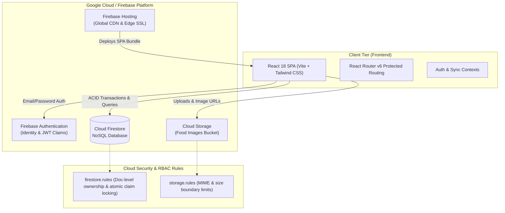

# FoodShare – Cloud-Based Food Donation & Redistribution Platform

> **Share More. Waste Less. Feed Communities.**  
> A production-ready, cloud-native web application built for college Cloud Computing coursework.

---

## 🌟 Overview

**FoodShare** is a full-stack, cloud-hosted platform connecting surplus food donors (restaurants, caterers, bakeries, grocery stores, and households) with community receivers (shelters, food pantries, NGOs, and individuals). Built on **React + Vite**, styled with **Tailwind CSS**, and backed by **Google Firebase Cloud Services**, it demonstrates enterprise cloud architecture, real-time NoSQL data synchronization, and role-based access control.

---

## 🏗️ Cloud Computing Architecture



### Cloud Services Utilized
1. **Google Cloud Firestore (NoSQL Document Database):**
   - Stores collections: `users`, `donations`, and `claims`.
   - Offers real-time synchronization, horizontal auto-scaling, and multi-region replication.
   - Enforces transactional concurrency to guarantee that two receivers cannot claim the same food item simultaneously.
2. **Firebase Authentication (Identity Management):**
   - Secure email/password credential management with cryptographically signed JSON Web Tokens (JWT).
   - Role-Based Access Control (RBAC) supporting **Donor**, **Receiver**, and **Admin** roles.
3. **Firebase Cloud Storage:**
   - Object store for food donation photography, supporting image upload validation (<5MB, valid image MIME types).
4. **Firebase Hosting:**
   - Worldwide Edge CDN deployment with automated HTTPS certificates and SPA rewrites.

---

## 🗄️ Cloud Firestore Collections Schema

### 1. `users` Collection
| Field | Type | Description |
|---|---|---|
| `uid` | string | Unique Firebase Authentication User ID (Document ID) |
| `name` | string | Full name or business / organization name |
| `email` | string | Account email address |
| `phone` | string | Contact phone number for pickup coordination |
| `role` | string | `"Donor"` \| `"Receiver"` \| `"Admin"` |
| `createdAt` | timestamp | Cloud timestamp of account registration |

### 2. `donations` Collection
| Field | Type | Description |
|---|---|---|
| `donationId` | string | Unique document identifier |
| `donorId` | string | Foreign key referencing `users.uid` of the poster |
| `donorName` | string | Organization or individual name |
| `donorEmail` | string | Contact email |
| `donorPhone` | string | Contact phone number |
| `foodName` | string | Title of the surplus food donation |
| `description` | string | Preparation notes, ingredients, dietary flags |
| `category` | string | `"Cooked Food"` \| `"Fruits"` \| `"Vegetables"` \| `"Bakery"` \| `"Packaged Food"` |
| `quantity` | string | Descriptive quantity (e.g., `"20 meal boxes"`, `"4 crates"`) |
| `servings` | number | Estimated number of people it can feed |
| `imageUrl` | string | Cloud Storage bucket URL or curated asset |
| `location` | string | Physical pickup address |
| `contact` | string | Contact phone number for verified receivers |
| `preparedAt` | timestamp | Time when food was prepared |
| `expiryAt` | timestamp | Best-before / pickup deadline |
| `status` | string | `"available"` \| `"claimed"` \| `"completed"` |
| `claimedBy` | string (optional) | UID of claiming receiver |
| `claimId` | string (optional) | Reference to the `claims` record |
| `claimantInfo`| map (optional) | Cached claimant name, phone, email |
| `isDemo` | boolean (optional)| Identified as demo evaluation data |
| `createdAt` | timestamp | Listing creation timestamp |

### 3. `claims` Collection
| Field | Type | Description |
|---|---|---|
| `claimId` | string | Unique claim audit document ID |
| `donationId` | string | Reference to `donations.donationId` |
| `donorId` | string | Reference to donor `users.uid` |
| `donorName` | string | Donor name |
| `donorContact`| string | Donor contact phone |
| `receiverId` | string | Foreign key referencing claimant `users.uid` |
| `receiverName`| string | Receiver name or organization |
| `receiverPhone`| string | Verified receiver phone for pickup coordination |
| `pickupLocation`| string| Location where food must be collected |
| `status` | string | `"active"` \| `"completed"` \| `"cancelled"` |
| `claimedAt` | timestamp | Timestamp when claim was registered |
| `completedAt` | timestamp (opt)| Timestamp when food was handed over |

---

## 🔒 Cloud Security Rules

The project includes formal Firebase Security Rules files:

- **`firestore.rules`**:
  - Enforces authenticated writes.
  - Ensures users can only edit their own user profiles (`users/{userId}`).
  - Enforces that only the creator can edit or delete their food donation.
  - Prevents donors from claiming their own listings.
  - Enforces that a donation can only transition from `available` to `claimed` if it is currently available.
  - Secures claims so only the assigned donor and receiver can view the record.
- **`storage.rules`**:
  - Validates image uploads, restricting sizes to `< 5MB` and verifying `contentType.matches('image/.*')`.

---

## 🚀 Getting Started & Local Development

### 1. Prerequisites
- Node.js (v18 or higher recommended)
- npm or pnpm

### 2. Install Dependencies
```bash
npm install
```

### 3. Environment Variables (.env)
Copy `.env.example` to `.env`:
```bash
cp .env.example .env
```
Populate your Firebase configuration keys:
```env
VITE_FIREBASE_API_KEY=AIzaSy...
VITE_FIREBASE_AUTH_DOMAIN=foodshare-demo.firebaseapp.com
VITE_FIREBASE_PROJECT_ID=foodshare-demo
VITE_FIREBASE_STORAGE_BUCKET=foodshare-demo.appspot.com
VITE_FIREBASE_MESSAGING_SENDER_ID=1234567890
VITE_FIREBASE_APP_ID=1:1234567890:web:abcdef
```

> **Note on Evaluation:** If Firebase credentials are not yet supplied, FoodShare features an **Interactive Cloud Sandbox Mode**. You can also enter and test your Firebase configuration directly in the app using the **Cloud Setup Modal**.

### 4. Run Development Server
```bash
npm run dev
```
Open [http://localhost:3000](http://localhost:3000) in your browser.

### 5. Build for Production
```bash
npm run build
```

---

## 🧪 Quick Evaluation Demo Logins

For fast testing and evaluator assessment, one-click demo logins are available on the `/login` page:

| Role | Email | Display Name | Permissions |
|---|---|---|---|
| **Donor** | `donor@foodshare.org` | Sarah Jenkins (Green Leaf Kitchen) | Post, edit, delete, view claims, mark complete |
| **Receiver** | `receiver@foodshare.org` | Hope Valley Food Pantry | Browse available food, claim donations, cancel claims |
| **Admin** | `admin@foodshare.org` | FoodShare Admin | Monitor all platform donations, metrics, and manage records |

### Official Demo Seed Records (1-Click Seeding)
The platform includes a **"Seed 4 Demo Donations"** button in both the UI and navigation:
1. **Fresh Vegetable Meals** – 20 servings (Cooked Food)
2. **Fresh Fruits Basket** – 10 servings (Fruits)
3. **Bread and Bakery Items** – 15 servings (Bakery)
4. **Rice and Dal** – 25 servings (Cooked Food)

---

## ☁️ Deployment to Firebase Hosting

```bash
# 1. Install Firebase CLI globally (if not already installed)
npm install -g firebase-tools

# 2. Login to Firebase
firebase login

# 3. Associate with your Firebase project
firebase use --add

# 4. Build production assets
npm run build

# 5. Deploy hosting and security rules
firebase deploy
```

---

## 📄 License
This project is developed for educational purposes as part of a College Cloud Computing curriculum.
